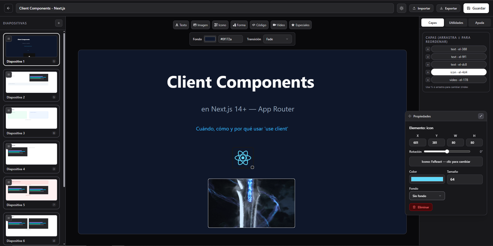

<h1 align="center">
  LivePresentations
</h1>

<p align="center">
  
  
  
  
  
  
  
  
  
</p>

<p align="center">
  
</p>

LivePresentations is a platform for creating, presenting, and controlling slides in real-time from your mobile device. Features a visual editor with a draggable canvas, rooms with QR codes and WebSocket support, presenter/controller mode, interactive questions, project variables, and presentation export/import functionality.

---

## Features

- **Dashboard** to create and organize presentations, generate rooms with unique codes and QR codes, view active rooms, and join as a controller by scanning the QR code.
- **Visual editor** with a 1280×720 canvas where you can drag, resize, rotate, and reorder layers; add text with multiple fonts and optional background, images, shapes, videos from files or YouTube, icons, and syntax-highlighted code blocks.
- **Interactive questions** with configurable special blocks: customize block text and colors, define the question, answers, and up to two additional code blocks.
- **Participant raffle** using a list of names saved as a variable; draw randomly with an animated slider or spinning wheel, configure spin duration, and optionally exclude drawn names to avoid repetition during the presentation.
- **Fully customizable Q&A**: write your question and choose its color and alignment, set the number of answers to display (2-6), format (A-D letters, 1-4 numbers, or free text), customize each option's text, and mark the correct answer.
- **Project variables** reusable throughout the presentation: create numeric, text, boolean, list, and object variables with content validation and use them to power raffles and other content.
- **Configurable rooms**: when creating a room, decide whether to show navigation controls, fill the screen with the presentation, display an anti-spoiler countdown screen at the start, and whether the browser automatically enters fullscreen when presenting.
- **Live presentation** with two synchronized views: the presenter sees the current slide while the controller changes slides, highlights elements, triggers animations, expands code blocks with highlighted lines, and controls the entire Q&A flow from the mobile device.
- **Borderless fullscreen** that automatically adapts the size and position of all elements to the window size without black bars.
- **Export and import** complete presentations as `.zip` files that include general information, each slide separately, variables, and all uploaded assets, with support for the previous `.json` format.
- **Light and dark themes** switchable throughout the interface.

---

## Architecture

Monorepo with `apps/frontend` + `apps/backend` using feature-based architecture. Frontend: `React 19 + TypeScript + Vite + Tailwind 4 + Framer Motion + Zustand` organized under `src/features/` (`editor/`, `player/`, `room/`) with base components in `src/components/ui/` (`Button`, `Modal`, `Select`, `Checkbox`, `CodeBlock`). Room state managed with `useRoom` and presentation data validated with `zod` (`presentationDataSchema`). Backend: `FastAPI + SQLAlchemy 2.0 (async) + aiosqlite + Uvicorn` with `app/api/routes/` (`presentations`, `rooms`, `uploads`), `app/services/presentation_package.py` for zip operations, and `app/ws/` for generic broadcast handling (`SPECIALS_*/ELEMENT_*/CUSTOM_*` messages) without modifying the backend for each new element type. SQLite database stored at `instance/livepresentations.db`. Frontend uses only `zustand` for external state management (`auth`/`theme`).

---

## Requirements

- Node 18+
- Python 3.10+
- Docker & Docker Compose (optional, for containerized deployment)

---

## Quick Start with Docker (Recommended)

The easiest way to get the project running is with Docker Compose:

```bash
git clone https://github.com/Zerik-Official/LivePresentations
cd LivePresentations
cp .env.example .env
docker-compose up
```

The application will be available at:
- Frontend: `http://localhost:5173`
- Backend API: `http://localhost:8000`
- API Documentation: `http://localhost:8000/docs`

To stop the services:

```bash
docker-compose down
```

To rebuild the images:

```bash
docker-compose up --build
```

---

## Manual Setup (Development)

### Clone the repository

```bash
git clone https://github.com/Zerik-Official/LivePresentations
cd LivePresentations
```

### Frontend Setup

```bash
cd apps/frontend
npm install
```

### Backend Setup

**Windows:**

```bash
cd apps/backend
python -m venv venv
venv\Scripts\activate
pip install -r requirements.txt
copy .env.example .env
```

**Linux / macOS:**

```bash
cd apps/backend
python3 -m venv venv
source venv/bin/activate
pip install -r requirements.txt
cp .env.example .env
```

---

## Running the Application

> For local network testing, ensure your presenter and controller are connected to the same network for real-time WebSocket communication.

### Frontend (Vite Development Server)

From the `apps/frontend` directory:

```bash
npm run dev -- --host
```

Available at `http://localhost:5173` and `http://<your-ip>:5173` for mobile devices.

### Backend (Uvicorn Development Server)

From the `apps/backend` directory:

```bash
uvicorn app.main:app --host 0.0.0.0 --port 8000 --reload
```

API available at `http://localhost:8000`, documentation at `http://localhost:8000/docs`, WebSocket at `/ws/room/{code}`.

#### Configuration

Settings are read from `apps/backend/.env`:
- `SECRET_KEY`: JWT secret key (generate with `openssl rand -hex 32`)
- `CORS_ORIGINS`: Comma-separated list of allowed origins (e.g., `http://localhost:5173,http://localhost:3000`)
- `ENABLE_TURNSTILLE_CAPTCHA`: Enable Cloudflare Turnstile CAPTCHA (default: `true`)
- `TURNSTILE_PUBLIC_KEY` & `TURNSTILE_PRIVATE_KEY`: Only required if CAPTCHA is enabled
- `UPLOAD_QUOTA_MB`: Maximum upload size per user in MB (default: 20)

If no `.env` file exists, CORS will be open to all origins.

In development, the frontend proxies API requests to `http://localhost:8000`. On desktop, open `http://<your-ip>:8000/docs` to test the API.

### Production Build

```bash
cd apps/frontend
npm run build
```

Generates `dist/` ready for deployment.

---

## Documentation

For more detailed information, check the documentation in the `docs/` folder:

- [DOCKER.md](docs/DOCKER.md) - Comprehensive Docker and Docker Compose guide
- [DEPLOYMENT_GUIDE.md](docs/DEPLOYMENT_GUIDE.md) - Quick deployment reference
- [SETUP_COMPLETE.md](docs/SETUP_COMPLETE.md) - Setup verification and next steps

---